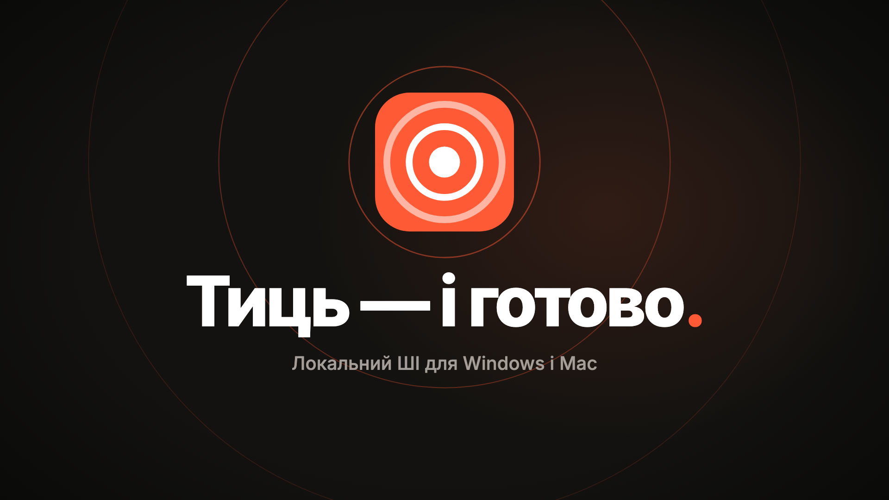

# Тиць (Tyts)

[English](README.md) · [Українська](README.uk.md) · **Русский**

*Тиць — и готово.* Программа в трее для Windows и Mac (Apple silicon): исправляет раскладку, печатает то, что вы говорите, записывает созвоны и подводит их итоги, переводит и помогает практиковать английский. Всё работает на нейросетях на вашем компьютере: без облака, без подписки, без аккаунта.

Сайт: [designmakc.github.io/tyts](https://designmakc.github.io/tyts/ru/). Тиць — форк [Kryakl](https://github.com/ikstro/kryakl) Евгения Пешинского.

[](docs/media/tyts-uk.mp4)

## Что умеет

Меню окна, в том порядке, в каком оно скорее всего понадобится:

- **Не та буква.** Набрали `ghbdtn` вместо `привет`? Тиць исправит слово прямо при наборе или по клавише (например, Pause): английский, украинский, русский и другие. Своя клавиша переключает раскладку, подсказка у курсора показывает текущую. Запоминает слова, которые вы исправили вручную, и никогда не учится в поле пароля.
- **Скажи — напишу.** Нажмите клавишу, говорите, нажмите снова: фраза напечатается там, где курсор. Можно сразу с переводом на английский или заметкой в папку заметок. Правка текста (сначала выключена) даёт локальной модели почистить фразу перед печатью.
- **Созвоны.** Записывает весь звук компьютера и ваш микрофон из любой программы для созвонов, расшифровывает, различает говорящих и пишет итог: решения, задачи, вопросы. Аудио- и видеофайлы тоже.
- **Перевод.** Выделите текст в любой программе и нажмите свою клавишу: у курсора откроется карточка с переводом, его можно прослушать. Или замените выделенное переводом, или переведите кусок экрана. Три уровня: Быстрый (переводчик Firefox), Точный и Самый точный (Gemma 4 на вашей видеокарте).
- **Практика.** Проверка английского: ошибки зачёркнуты, исправление зелёным, короткая заметка на вашем языке. Разговор с Тиць по-английски на уровне A2, B1 или B2.
- **Настройки.** Клавиши (клавиатура со всеми клавишами Тиць, там же их задать или поменять), Модели (на чём работает каждое действие и **Выбрать лучшее** для этого компьютера), Место на диске.

Одна клавиша может открыть меню Тиць у курсора, где действие выбирается буквой. **Ctrl K** (или Ctrl F) ищет по всем настройкам.

## Созвоны и скриншоты: полный контекст

Созвон — это не только слова: половина смысла в том, что было на экране. Тиць сохраняет и то, и другое.

- **Запись любого созвона.** Нажмите свою клавишу (или «Записать созвон» в трее) в Zoom, Teams, Telegram, Meet в браузере или где угодно ещё. Тиць записывает весь звук компьютера и ваш микрофон в одну запись; ничего никуда не отправляется.
- **Скриншоты для контекста.** Включите «Снимки экрана во время созвона», и Тиць будет сохранять экран каждые 4 секунды, если он изменился. Своя клавиша (или кнопка с камерой на панели записи) делает снимок в любой момент. Скриншоты лежат рядом с записью и удаляются вместе с ней.
- **Картинка у нужной строки.** Когда кто-то говорит «смотрите сюда», «как видите» или «на экране», расшифровка показывает скриншот этого момента рядом со строкой; ваши собственные снимки тоже.
- **Итог, который видел экран.** Локальная модель пишет решения, задачи и вопросы; текст со скриншотов служит ей контекстом, поэтому тема о показанном ссылается на свой снимок, например *(снимок 12:38)*. Клик открывает картинку или включает созвон с этого места.
- **Спросите свои созвоны.** На вопрос ко всем записям («когда мы перенесли релиз?») Тиць отвечает по расшифровкам, каждый ответ ведёт к своему моменту.

## Установка

**Windows 10 и 11:** скачайте `Tyts-Setup-<версия>.exe` в [релизах](https://github.com/designmakc/tyts/releases) и запустите. Установщик не подписан, поэтому Windows один раз предупредит: **Подробнее → Выполнить в любом случае**. Тиць запускается вместе с Windows и живёт в трее.

**Mac (Apple silicon):** скачайте `Tyts-<версия>-arm64.dmg`, перетащите Тиць в «Программы», в первый раз откройте через правый клик → **Открыть**. Когда macOS спросит, разрешите Универсальный доступ (для клавиатуры), микрофон и Запись экрана (для созвонов).

Когда выходит новая версия, Тиць при запуске спрашивает, обновиться ли. На Windows **Обновить** скачивает её, ставит поверх старой и снова запускает Тиць; на Mac скачивает и открывает новую версию, а вы перетаскиваете Тиць в «Программы». Настройки, слова и загрузки остаются. Это отдельная от Kryakl программа со своими папками.

Модели скачиваются только когда вы выбираете то, что их требует, и по одному разу. Всему Тиць нужен приличный компьютер: видеокарта с 4 ГБ своей памяти для точного перевода, практики и итогов созвонов, около 12 ГБ на диске. Исправление раскладки, быстрый перевод и голос Windows работают на любом компьютере.

## Сообщить о проблеме

Откройте **О Тиць и помощь › Сообщить о проблеме**, опишите, что случилось, и выберите **Почта** или **Задача на GitHub**. Тиць сохранит zip с журналами в `Documents\Tyts\Reports`, покажет его и откроет письмо с вашим текстом: приложите zip и отправьте. Сам Тиць ничего не отправляет.

В zip — журналы Тиць, процессор, память, видеокарта и версии, а также настройки, где ваши списки только посчитаны. В нём никогда нет ваших текстов, слов, ошибок, переводов, надиктованных фраз, расшифровок и ключа Hugging Face; имена учётной записи и компьютера заменены.

## Кто когда говорил: ключ Hugging Face

Чтобы различать говорящих, нужна модель pyannote, которую Hugging Face выдаёт бесплатно после согласия с условиями. Тиць попросит ключ один раз:

1. Зарегистрируйтесь на [huggingface.co/join](https://huggingface.co/join), бесплатно.
2. Откройте [страницу модели](https://huggingface.co/pyannote/speaker-diarization-community-1), заполните форму (Use case: **Meeting note taker**) и нажмите **Agree and access repository**.
3. Откройте [Access Tokens](https://huggingface.co/settings/tokens) → **Create new token** → тип **Read** → скопируйте ключ `hf_…`.
4. Вставьте его в Тиць и нажмите **Сохранить**. Модель скачается один раз, дальше всё работает без интернета. Ключ остаётся только на вашем компьютере.

## Языки

Интерфейс — английский, украинский или русский. Практикуется английский. Ваш язык может быть одним из 31 с офлайн-переводчиком в обе стороны (украинский, русский, немецкий, французский, испанский, польский и другие).

## Сборка

```
npm install
npm test
npm run typecheck
npm start            # собрать и запустить из исходников
npm run dist         # release/Tyts-Setup-<version>.exe
npm run dist:mac     # release/Tyts-<version>-arm64.dmg
npm run icons        # build/icon.svg → иконки приложения и трея
npx electron scripts/og.mjs   # картинки ссылок для сайта
```

Тег `v<version>` собирает установщик для Windows в GitHub Actions и готовит черновик релиза. Как всё устроено — в [CLAUDE.md](CLAUDE.md).

## Авторы

Микола Оникийчук — Telegram [@designmakc](https://t.me/designmakc). Основано на [Kryakl](https://github.com/ikstro/kryakl) Евгения Пешинского. Лицензия MIT; сторонние части — в [NOTICE](NOTICE).
