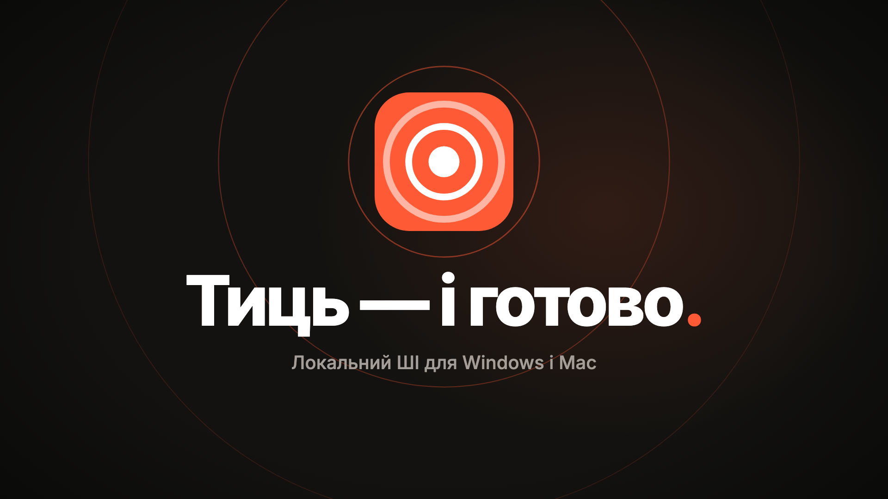

# Тиць (Tyts)

[English](README.md) · **Українська** · [Русский](README.ru.md)

*Тиць — і готово.* Програма в треї для Windows і Mac (Apple silicon): виправляє розкладку, друкує те, що ви кажете, записує дзвінки й підбиває їхні підсумки, перекладає і допомагає практикувати англійську. Усе працює на нейромережах на вашому комп’ютері: без хмари, без підписки, без акаунта.

Сайт: [designmakc.github.io/tyts](https://designmakc.github.io/tyts/uk/). Тиць — форк [Kryakl](https://github.com/ikstro/kryakl) Євгена Пешинського.

[](docs/media/tyts-uk.mp4)

## Що вміє

Меню вікна, у тому порядку, у якому воно найпевніше знадобиться:

- **Не та літера.** Набрали `ghbdtn` замість `привет`? Тиць виправить слово просто під час набору або клавішею (наприклад, Pause): англійська, українська, російська та інші. Своя клавіша перемикає розкладку, підказка біля курсора показує поточну. Запам’ятовує слова, які ви виправили вручну, і ніколи не вчиться в полі пароля.
- **Скажи — надрукую.** Натисніть клавішу, говоріть, натисніть ще раз: фраза надрукується там, де курсор. Можна одразу з перекладом англійською або нотаткою в папку нотаток. Редагування тексту (спершу вимкнене) дає локальній моделі почистити фразу перед друком.
- **Дзвінки.** Записує весь звук комп’ютера й ваш мікрофон з будь-якої програми для дзвінків, розшифровує, розрізняє мовців і пише підсумок: рішення, завдання, питання. Аудіо- й відеофайли теж.
- **Переклад.** Виділіть текст у будь-якій програмі й натисніть свою клавішу: біля курсора відкриється картка з перекладом, його можна прослухати. Або замініть виділене перекладом, або перекладіть шматок екрана. Три рівні: Швидкий (перекладач Firefox), Точний і Найточніший (Gemma 4 на вашій відеокарті).
- **Практика.** Перевірка англійської: помилки закреслені, виправлення зеленим, коротка примітка вашою мовою. Розмова з Тиць англійською на рівні A2, B1 або B2.
- **Налаштування.** Клавіші (клавіатура з усіма клавішами Тиць, там само їх задати чи змінити), Моделі (на чому працює кожна дія і **Вибрати найкраще** для цього комп’ютера), Місце на диску.

Одна клавіша може відкрити меню Тиць біля курсора, де дію вибирають літерою. **Ctrl K** (або Ctrl F) шукає в усіх налаштуваннях.

## Дзвінки й знімки екрана: повний контекст

Дзвінок — це не лише слова: половина сенсу в тому, що було на екрані. Тиць зберігає і те, і те.

- **Запис будь-якого дзвінка.** Натисніть свою клавішу (або «Записати дзвінок» у треї) у Zoom, Teams, Telegram, Meet у браузері чи будь-де ще. Тиць записує весь звук комп’ютера й ваш мікрофон в один запис; нічого нікуди не надсилається.
- **Знімки для контексту.** Увімкніть «Знімки екрана під час дзвінка», і Тиць зберігатиме екран кожні 4 секунди, якщо він змінився. Своя клавіша (або кнопка з камерою на панелі запису) робить знімок будь-коли. Знімки лежать поруч із записом і видаляються разом із ним.
- **Картинка біля потрібного рядка.** Коли хтось каже «дивіться сюди», «як бачите» чи «на екрані», транскрипт показує знімок того моменту поруч із рядком; ваші власні знімки теж.
- **Підсумок, який бачив екран.** Локальна модель пише рішення, завдання й питання; текст зі знімків слугує їй контекстом, тож тема про показане посилається на свій знімок, наприклад *(знімок 12:38)*. Клік відкриває картинку або вмикає дзвінок із цього місця.
- **Запитайте свої дзвінки.** На питання до всіх записів («коли ми перенесли реліз?») Тиць відповідає за транскриптами, кожна відповідь веде до свого моменту.

## Встановлення

**Windows 10 і 11:** завантажте `Tyts-Setup-<версія>.exe` з [релізів](https://github.com/designmakc/tyts/releases) і запустіть. Інсталятор не підписаний, тож Windows один раз попередить: **Докладніше → Усе одно запустити**. Тиць запускається разом із Windows і живе в треї.

**Mac (Apple silicon):** завантажте `Tyts-<версія>-arm64.dmg`, перетягніть Тиць у «Програми», уперше відкрийте через правий клік → **Відкрити**. Коли macOS спитає, дозвольте Універсальний доступ (для клавіатури), мікрофон і Запис екрана (для дзвінків).

Коли виходить нова версія, Тиць під час запуску питає, чи оновитися. На Windows **Оновити** завантажує її, ставить поверх старої й знову запускає Тиць; на Mac завантажує й відкриває нову версію, а ви перетягуєте Тиць у «Програми». Налаштування, слова й завантаження лишаються. Це окрема від Kryakl програма зі своїми папками.

Моделі завантажуються лише тоді, коли ви обираєте те, що їх потребує, і по одному разу. Усьому Тиць потрібен пристойний комп’ютер: відеокарта з 4 ГБ власної пам’яті для точного перекладу, практики й підсумків дзвінків, близько 12 ГБ на диску. Виправлення розкладки, швидкий переклад і голос Windows працюють на будь-якому комп’ютері.

## Повідомити про проблему

Відкрийте **Про Тиць і допомога › Повідомити про проблему**, опишіть, що сталося, і виберіть **Пошта** або **Задача на GitHub**. Тиць збереже zip із журналами в `Documents\Tyts\Reports`, покаже його й відкриє лист із вашим текстом: додайте zip і надішліть. Сам Тиць нічого не надсилає.

У zip — журнали Тиць, процесор, пам’ять, відеокарта й версії, а також налаштування, де ваші списки лише пораховані. У ньому ніколи немає ваших текстів, слів, помилок, перекладів, надиктованих фраз, транскриптів і ключа Hugging Face; імена облікового запису й комп’ютера замінені.

## Хто коли говорив: ключ Hugging Face

Щоб розрізняти мовців, потрібна модель pyannote, яку Hugging Face видає безкоштовно після згоди з умовами. Тиць попросить ключ один раз:

1. Зареєструйтеся на [huggingface.co/join](https://huggingface.co/join), безкоштовно.
2. Відкрийте [сторінку моделі](https://huggingface.co/pyannote/speaker-diarization-community-1), заповніть форму (Use case: **Meeting note taker**) і натисніть **Agree and access repository**.
3. Відкрийте [Access Tokens](https://huggingface.co/settings/tokens) → **Create new token** → тип **Read** → скопіюйте ключ `hf_…`.
4. Вставте його в Тиць і натисніть **Зберегти**. Модель завантажиться один раз, далі все працює без інтернету. Ключ лишається тільки на вашому комп’ютері.

## Мови

Інтерфейс — англійська, українська або російська. Практикується англійська. Ваша мова може бути однією з 31 з офлайн-перекладачем в обидва боки (українська, російська, німецька, французька, іспанська, польська та інші).

## Збирання

```
npm install
npm test
npm run typecheck
npm start            # зібрати й запустити з вихідного коду
npm run dist         # release/Tyts-Setup-<version>.exe
npm run dist:mac     # release/Tyts-<version>-arm64.dmg
npm run icons        # build/icon.svg → іконки застосунку й трея
npx electron scripts/og.mjs   # картинки посилань для сайту
```

Тег `v<version>` збирає інсталятор для Windows у GitHub Actions і готує чернетку релізу. Як усе влаштовано — у [CLAUDE.md](CLAUDE.md).

## Автори

Микола Оникійчук — Telegram [@designmakc](https://t.me/designmakc). На основі [Kryakl](https://github.com/ikstro/kryakl) Євгена Пешинського. Ліцензія MIT; сторонні частини — у [NOTICE](NOTICE).
